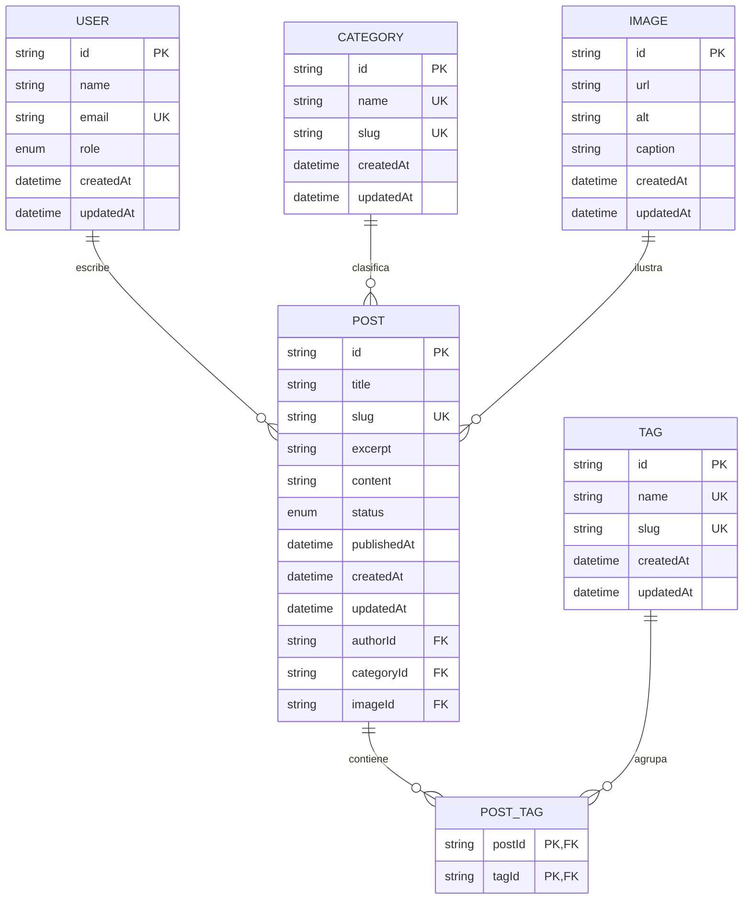

# Diagrama entidad relacion - Bilwi Noticias

## Lectura del modelo

- `USER` representa a los autores o administradores que crean contenido.
- `CATEGORY` representa la seccion editorial de una noticia.
- `TAG` permite etiquetar noticias con temas o palabras clave.
- `IMAGE` almacena la imagen principal o de apoyo de la noticia.
- `POST` es la entidad central del periodico digital.
- `POST_TAG` resuelve la relacion muchos-a-muchos entre noticias y etiquetas.

## Notas de negocio

- `authorId`, `categoryId` e `imageId` son opcionales en el esquema actual.
- `slug` identifica de forma unica cada noticia.
- `status` controla si una noticia esta en borrador, publicada o archivada.
- La moderacion de comentarios se maneja fuera de este ER principal en un almacenamiento JSON de apoyo.
