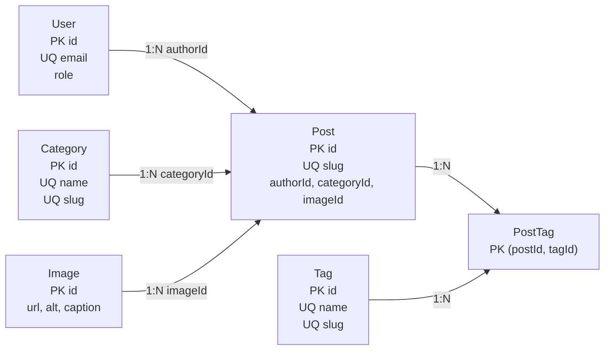

# Diagrama relacional - Bilwi Noticias

Este diagrama resume la estructura relacional principal del proyecto, basada en Prisma y PostgreSQL.
Las entidades de apoyo que hoy se guardan en JSON para administracion y moderacion se documentan aparte.

## Cardinalidades

- Un `User` puede escribir muchas `Post`.
- Una `Category` puede agrupar muchas `Post`.
- Una `Image` puede relacionarse con muchas `Post`.
- Un `Post` puede tener muchos `Tag` mediante la tabla puente `PostTag`.
- Un `Tag` puede pertenecer a muchos `Post` mediante la tabla puente `PostTag`.

## Observacion

Los comentarios y parte de la administracion actual usan archivos JSON de soporte:

- `data/comments.json`
- `data/admin-auth.json`
- `data/admin-categories.json`
- `data/admin-users.json`

Esos archivos no forman parte del esquema relacional principal, pero si forman parte del flujo funcional del proyecto.
